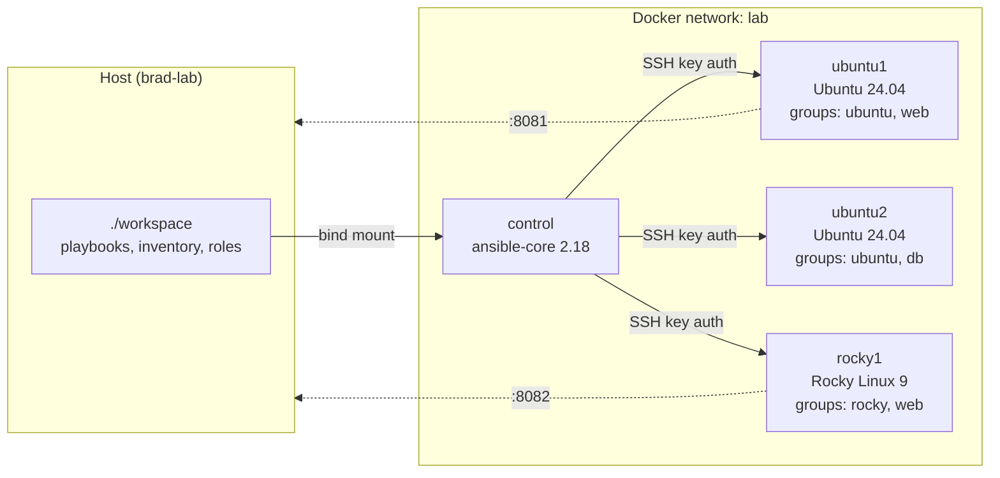

# ansible-lab

An immutable, disposable Ansible practice lab that runs on one Linux machine with Docker.

- **1 control node** with a pinned `ansible-core` and common collections
- **3 managed nodes** that boot real **systemd** and **sshd**: two Ubuntu 24.04 and one Rocky Linux 9, so you practice against both the Debian and RHEL families
- **Key-only SSH** with a keypair generated fresh on every rebuild; nothing secret is committed
- **One command** (`./lab reset`) wipes it all and brings back a clean lab in about a minute
- **CI** lints every playbook and proves `site.yml` is idempotent on every push

> **Immutable means:** you never repair a node by hand. If you break something, rebuild it.
> Your playbooks live in `./workspace` on the host and survive every reset.



## 1. Requirements

- Linux host with Docker Engine and the Compose v2 plugin (`docker compose version`)
- cgroup v2 (default on Linux Mint 21+, Ubuntu 22.04+)
- About 2 GB of free RAM and 3 GB of disk for the images
- Your user in the `docker` group (`sudo usermod -aG docker $USER`, then log out and back in)

## 2. Quick start

```bash
git clone git@github.com:bbrooks89/ansible-lab.git
cd ansible-lab
./lab up          # first build takes a few minutes
./lab ping        # every node should say SUCCESS
./lab run site.yml
./lab run site.yml   # run it again: changed=0 everywhere
```

Then open <http://localhost:8081> (ubuntu1) and <http://localhost:8082> (rocky1).

## 3. Commands

| Command | What it does |
|---|---|
| `./lab up` | Build if needed, start, wait until every node answers Ansible ping |
| `./lab shell` | Bash on the control node as `ansible`, in `~/lab` (your `./workspace`) |
| `./lab ping` | `ansible all -m ping` |
| `./lab run <playbook> [args]` | Run `playbooks/<playbook>`; extra args pass through (`--check --diff`, `-l rocky`, `-t tag`) |
| `./lab ssh <node>` | SSH from the control node into a managed node, the way Ansible does |
| `./lab console <node>` | Root shell via `docker exec`, for when SSH itself is broken |
| `./lab reset` | Destroy containers and volumes, rebuild, wait for ready |
| `./lab down` | Stop the lab (keeps images) |
| `./lab destroy` | Remove containers, volumes and lab images |
| `./lab status` / `./lab logs [svc]` | Container status and logs |

## 4. Layout

```text
ansible-lab/
├── lab                     # helper CLI
├── compose.yaml            # control + 3 managed nodes
├── control/                # control node image (Ansible, pinned)
│   ├── Dockerfile
│   ├── entrypoint.sh       # generates the lab keypair on first start
│   ├── requirements.txt    # ansible-core version pin
│   └── requirements.yml    # collections
├── nodes/                  # managed node images (systemd + sshd)
│   ├── common/             # first-boot unit, sshd hardening
│   ├── ubuntu/Dockerfile
│   └── rocky/Dockerfile
├── workspace/              # mounted at ~/lab on the control node
│   ├── ansible.cfg
│   ├── inventory/
│   │   ├── hosts.yml
│   │   └── group_vars/
│   ├── playbooks/          # 00-ping, 01-facts, 02-baseline, 03-webserver, site
│   └── roles/webserver/
├── EXERCISES.md            # numbered practice tasks
└── .github/workflows/lab.yml
```

## 5. How it works

1. **Control node starts first.** Its entrypoint generates an ed25519 keypair if the volumes are empty. The private key goes in the `lab-secret` volume, which only the control node mounts. The public key goes in `lab-pubkey`.
2. **Managed nodes wait** on the control node's healthcheck, so they never boot before a key exists.
3. **Each managed node boots systemd.** A `lab-firstboot` unit runs before sshd: it generates unique SSH host keys (the images ship with none) and installs the public key for the `ansible` user from the read-only `lab-pubkey` volume.
4. **`./lab reset`** runs `docker compose down -v`, which deletes both volumes. Next start means a new keypair, new host keys and fresh containers. `host_key_checking` is off in `ansible.cfg` for this reason only; never do that on real servers.

The `ansible` user on each node has passwordless sudo and no password, so SSH keys are the only way in.

## 6. Adding a node

1. Add a service to `compose.yaml` using the `<<: *managed-node` anchor (copy `ubuntu2`).
2. Add the host to `workspace/inventory/hosts.yml`.
3. `./lab up`

## 7. Troubleshooting

| Symptom | Fix |
|---|---|
| Node exits right away, or `./lab console` shows systemd errors about cgroups | Check `stat -fc %T /sys/fs/cgroup` prints `cgroup2fs`. If it does and it still fails, uncomment `privileged: true` in the `x-managed-node` block of `compose.yaml`. |
| `UNREACHABLE` after a reset | Give it a few seconds; `./lab ping`. Then `./lab console <node>` and `systemctl status lab-firstboot ssh` (`sshd` on Rocky). |
| `Bind for 0.0.0.0:8081 failed: port is already allocated` | `UBUNTU1_HTTP_PORT=9081 ROCKY1_HTTP_PORT=9082 ./lab up` |
| Files in `workspace/` owned by the wrong user | `./lab` passes your UID into the image. If you built with plain `docker compose`, run `./lab reset`. |
| `permission denied ... docker.sock` | Add yourself to the `docker` group and log in again. |

## 8. Limits (it's containers, not VMs)

The nodes share the host kernel, so these won't behave like a real server: kernel modules, `sysctl` on most keys, `reboot` (it stops the container), mounts and block devices, SELinux, firewalld/ufw rules, and `timedatectl`. For those, use VMs (Vagrant or KVM). Packages, files, templates, users, services, handlers, roles, facts, loops, conditionals, vault, check mode and idempotence all behave as they do on real hosts.

## License

MIT
